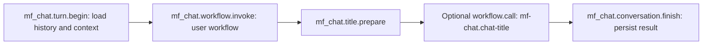

# Embedded chat core

The `mf-chat` library owns SQLite storage for multiple chat sessions. Direct database APIs and application-owned `mf_chat.*` nodes share the same storage handlers. It does not initialize a terminal or launch workflow runner processes.

## Database initialization

Open an explicit database path:

```rust
let database = mf_chat::ChatDatabase::open("state/chat.sqlite")?;
println!("{}", database.path().display());
```

The owner creates the parent directory, acquires an exclusive sibling lock, initializes storage directly, and keeps the lock until dropped. Another owning host receives a typed busy error. Startup applies embedded pending migrations and enables WAL, foreign keys, and a finite busy timeout. No external migration files or tools are needed.

Node preparation validates contracts without opening storage. Failures retain typed filesystem, connection, query, and migration sources through `ChatError`.

Persisted records distinguish sessions, ordered messages, conversation turns, and model calls. One conversation execution can report both conversation and title model calls without adding title messages. Schema rollback is an explicit development operation on disposable databases; startup only applies pending forward migrations.

## Sessions and history

Database APIs call storage handlers directly, without constructing or executing workflows.
They return storage variants of `ChatError` directly; callers can match domain errors without traversing runtime wrappers:

```rust
let session = database.create_session("default", Some("Answer briefly".into()), None)?;
database.rename_session(&session.id, "Project questions")?;
database.archive_session(&session.id)?;
database.restore_session(&session.id)?;
let page = database.list_sessions(false, 50, None)?;
let messages = database.messages(&session.id, 50, None)?;
let context = database.history(&session.id, mf_chat::DEFAULT_HISTORY_BYTES)?;
```

Lists use bounded keyset pages. Pass `next_after` back as the next cursor. Session order is creation time followed by stable ID; message order uses a per-session sequence. Message results include each turn's state, so unsuccessful submissions remain inspectable. Archiving retains messages and call records and prevents new turns until restoration.

History includes only completed successful turns from the requested session. It keeps system instructions separate and excludes unsuccessful submissions and the current prompt. The default canonical history JSON bound is 1 MiB; exceeding it fails explicitly without deleting or trimming messages.

Registered kinds are `mf_chat.session.create`, `.list`, `.load`, `.rename`, `.archive`, `.restore`, `mf_chat.messages.list`, and `mf_chat.history.load`. All node inputs name an explicit database path; node preparation never reads storage.

## Turn lifecycle

`mf_chat.turn.begin` atomically records a user message, running turn, and running model call. It reserves message order and loads successful history before releasing its short transaction. Only one conversation turn may run in a session; another session can still use the database while the provider is pending.

`mf_chat.turn.complete` saves the assistant message, reported usages, optional title candidate, and successful turn state together. It applies an eligible title in the same transaction. Replaying the same call and response returns the saved completion. Reusing its identity with different text, metadata, title, or usages fails. A failure halfway through completion leaves no assistant message or partial usage update.

`mf_chat.turn.fail` and `mf_chat.call.fail` finalize unsuccessful work and cannot overwrite committed success. Error summaries are bounded, while live errors retain typed sources. `mf_chat.turn.load` and `mf_chat.call.load` expose individual records for inspection.

A model retry creates a fresh turn and call and retains `retry_of` pointing to the original unsuccessful turn. A persistence retry reuses the original identity and response and never invokes the model again. Their database transitions are distinct.

Opening a database under its ownership lock calls the recovery handler directly: abandoned running work becomes interrupted and never automatically resends a request. A crash after a remote reply but before persistence can lose that reply and its usage. Interrupted usage remains unknown; it is not recorded as zero.

## Embedded conversation host

`ChatHost` owns the database, workflow profiles, admission limits, and execution workers. Each
submission executes the embedded application `conversation` flow:



The invocation node binds a `ConversationBackend` supplied by the host. Both the embedded Rust backend
and the executable backend use the same `ConversationInputs` / `ConversationResult` protocol. The
application flow owns durable turn admission and settlement; the user workflow owns answer generation
and explicit usage collection. When its public inputs support it, the host appends the built-in title
Flow; user workflows can also own title generation explicitly. User workflows need only generic nodes and
have no `mf-chat` dependency. The application never identifies or reconfigures their internal model nodes.

```rust
let definition = serde_json::from_str(&std::fs::read_to_string("examples/chat-title-flow.json")?)?;
let profile = mf_chat::WorkflowProfile::new("default", definition, Default::default())?;
let host = mf_chat::ChatHost::open("state/chat.sqlite", mf_chat::HostConfig::new(profile))?;
let session = host.database().create_session("default", Some("Answer briefly".into()), None)?;
let mut job = host.submit(&session.id, "Hello")?;
let identity = job.invocation().clone();
while !job.poll() {
    std::thread::sleep(std::time::Duration::from_millis(10));
}
let completion = job.join()?;
host.close()?;
```

`poll` is nonblocking, `join` waits for a result, and `cancel` requests cooperative cancellation. Dropping a job cancels that job; dropping or closing the host cancels and joins all its workers before releasing database ownership. The default host admits four active workflows, separately from the runtime's internal domain limit. A busy session or full host returns an explicit admission error.

Profiles contain a validated user workflow and its resolved configuration parameters, or an injected
`ConversationBackend`. Parameter environment bindings are resolved when a profile is constructed;
model-specific environment references remain owned by the user workflow. Sessions keep their profile
and system instructions. Actual model identities and per-call purpose/profile labels arrive through
`usages`; the host does not select a separate title model. An optional observer receives the application
flow and the supplied embedded workflow's preparation and execution lifecycle.

The flow owns failure policy. The title example uses `capture_errors` to report provider failures as data; the host persists the returned status and usages. An execution error or cancellation with no final result finalizes begun work through storage handlers independently of the cancelled execution context. The host does not inspect internal node outputs, recover intermediate replies, or retry a failed stage.
If cleanup also fails, `ChatError::Execution` retains both typed errors and invocation identities. A reply whose storage write fails returns `ChatError::Uncommitted`; pass its retained value to `retry_completion` or explicitly abandon it. Repeated persistence failures return the retained reply again and never resend a model request. `retry` starts a fresh model call for an unsuccessful original turn.

Run the two-turn example with an available model and credentials in the environment:

```sh
OPENAI_API_KEY=your-key nix develop --command cargo run -p mf-chat --example conversation -- state/chat.sqlite examples/chat-title-flow.json
```

Configure the model and endpoint in the supplied workflow. The example prints complete results with their session, turn, and call identities.

## Session title summaries

`ChatHost` and `mf run --chat` enable the built-in title Flow when the chat workflow exposes exactly
one string input for each of `model`, `base_url`, and `api_key`, with nonblank resolved values.
Defaults, environment bindings, and secret markers are preserved. Missing or ambiguous inputs skip
this feature; a declared `title` output leaves title generation to the user workflow. A returned title
or usage attributed to `title` also prevents a duplicate call.

After the chat stream closes, the route publishes one `ConversationCompleted` event.
`mf_chat.title.prepare` prepares the optional title call and supplies the inputs to the
`workflow.call` of `mf-chat.chat-title`. `mf_chat.conversation.finish` combines the completed
conversation with the title result and saves it through the existing turn-completion transaction.
The route does not interpret title policy or expose model-specific ports. The shared title Flow is
unchanged. `HostConfig::automatic_titles = false` disables the call. Custom `ConversationBackend`
implementations can supply resolved inputs through `builtin_title_parameters`; its default is disabled.

For a compact reusable composition, use the [nested title Flow](../examples/chat-nested-title-flow.json).
It calls the `mf-chat`-owned `mf-chat.chat-title` Flow through `workflow.call`; the parent retains primary answer
streaming and combines both usage lists. See [reusable Flows](workflows.md#reusable-flows) for its
interface and local-source support.

The supplied user flow may generate a title after a successful primary call. Its `context.title` input
contains the current title source, revision, whether an attempt has been recorded, and whether automatic
titles are enabled. The [conversation and title example](../examples/chat-title-flow.json) decides
eligibility from that context and uses the current prompt and answer as the title source. It can be
compiled and used directly with `--chat`:

```sh
mf compile examples/chat-title-flow.json --output chat-title-flow
mf run ./chat-title-flow --chat --chat-db state/chat.sqlite --params.model your-model
```

Both model configurations belong to this user flow; change `title_model.config` to use a different model
or provider. `HostConfig::automatic_titles = false` supplies a disabled context policy to embedded
backends. Both calls report their purpose through `usages[].attribution`. The example uses one
configuration and omits the optional profile label. It preserves a successful answer when the title provider reports failure, retains the failed call's usage,
and omits the title output. This policy is expressed by its branches. The application flow only persists
the final protocol result.

A submission finishes after the user flow and any appended title Flow finish. There is no separate background title job,
startup scan, title retry API, or title completion queue. Cancellation before delivery can lose the
whole result and its usage; the host does not infer which internal calls completed. Persisted title
attempts, including failures, suppress subsequent automatic attempts. Unknown attempts cannot be
inferred from an interrupted workflow. Legacy never-started pending title jobs are retired on upgrade.

The terminal uses the first prompt line as a provisional display title. `create_provisional_session`
provides the same replaceable placeholder for other hosts; `create_session` with an explicit title still
means a manual name. Manual names always take precedence. Saving compares the admission-time title revision with the current
session revision. A rename during execution preserves the manual title while saving the answer and all
reported calls. Generated titles are trimmed, nonempty, free of control characters, and at most 120
characters. Invalid or stale candidates do not prevent saving the primary result. The original candidate
is retained for idempotent replay. A database failure rolls back the whole completion; `retry_completion`
or `save_recovered` saves the retained result without invoking either model again.

## Shared conversation contract

`mf_chat::contract` owns the common contract, argument binding, and result reconciliation for both
execution backends. `ConversationInputs` contains `prompt`, optional `system`, optional `history`, and
optional `context`. Context is application-owned input rather than a caller-supplied configuration
parameter. A workflow that does not declare context continues to receive only the inputs it supports.

```json
{
  "title": {
    "source": "provisional",
    "revision": 0,
    "attempted": false,
    "enabled": true
  }
}
```

`ConversationResult` contains `status`, `text`, `usages`, optional message `metadata`, `finish_reason`,
`error`, and optional `title`. `Completion.result` retains this result. A failed result requires an error
summary and cannot update the title. A successful result requires nonempty text. The title is a candidate,
not confirmation that a concurrent rename allowed it to be applied. Read the saved session for its title.

Context and optional outputs can later carry compaction state and a summary proposal. No compaction is
implemented: history loading still enforces the canonical byte bound before execution. A future compaction
stage also needs a history-loading policy and revision-checked summary persistence.

## Usage statistics

The former `flows::usage_statistics` module is removed; use `ChatDatabase::usage` or `ChatHost::usage`.
`usage` calls the query handler directly; `mf_chat.usage.query` exposes the same handler to workflows. It reads committed call facts in one SQLite snapshot and never invokes a model or changes billing records.

```rust
let statistics = host.usage(mf_chat::UsageQuery {
    session_id: Some(session.id.clone()),
    purpose: Some(mf_chat::CallPurpose::Conversation),
    group_by: Some(mf_chat::UsageGrouping::Model),
    limit: 50,
    ..Default::default()
})?;
```

Filters accept session, profile, actual model name, purpose, and call start times in UTC Unix milliseconds. Start is inclusive and end is exclusive. Group by session, model, profile, purpose, or UTC day. Pass `next_after` to fetch the next group page; the overall summary always covers the complete filter.

Each token counter exposes `known_subtotal`, `reported_calls`, and `missing_calls`. A missing observation is not zero; an explicit zero is a reported observation. No observations yield an unknown subtotal. Treat a subtotal with missing observations as partial coverage. Attempt and status counts include begun failed, cancelled, and interrupted calls, but exclude never-started title requests.

`mfn-llm::CallUsage` contains raw provider call facts. The application-owned `mf-chat::CallUsage`
adds `timing.elapsed_us` and optional `timing.first_token_us` while preserving the flat JSON contract.
Timing validation, token-rate calculation, and persistence belong to `mf-chat`; the LLM node has no metric model.
The LLM node emits `llm.request.started`, `llm.response.first_text`, and `llm.request.finished` observations.
The observation layer stamps source Unix nanoseconds once. LLM execution has no elapsed-time recorder.
The first-text event precedes publication and backpressure; empty and metadata-only values do not emit it.
`mf-chat` correlates events by `call_id` and derives microsecond differences before persistence. Its local collector
uses the telemetry observation Context and works without external tracing exporters. A local no-export Observer
propagates it into concurrent and nested domains when the host supplies no Observer.
Executable chat collects the same `mf.observation` events through OTLP and applies their source timestamps before
settlement or save-only recovery. TUI graph cards use the same aggregation and can display event-derived call facts
before business snapshots arrive. Unary calls have no first-text event. Missing, conflicting, or noncausal event
sequences remain unknown; receiver arrival times are never substituted. Older stored timing remains readable.
Raw standalone node outputs retain call facts without computing timing; the hosting application owns enrichment.

`CallUsage::token_rates()` derives two optional rates from the saved output-token count and timing:

- `end_to_end_tokens_per_second`: output tokens divided by the whole request duration.
- `generation_tokens_per_second`: output tokens divided by request duration minus FTT.

The counters are provider-reported completion tokens, never streamed chunk counts. Missing counters,
failed calls, and zero-duration rate windows remain unknown; a reported zero token count yields zero
when the window is positive. These are client-observed rates and include local stream backpressure.
They are not server-only decoding measurements. Raw integer timing is stored with the response so a
save-only retry preserves the original observations and does not recalculate elapsed time.

`statistics.overall.performance` and every group's `performance` expose `elapsed` and `first_token`
latencies (`total_us`, `mean_ms`), plus `end_to_end` and `generation` throughput (`output_tokens`,
`elapsed_us`, `tokens_per_second`). Every measure includes `reported_calls` and `missing_calls`.
Aggregated rates divide summed paired tokens by summed positive durations instead of averaging
per-call rates. Filters and group pagination use the same persisted snapshot as token statistics.

SQL computes aggregate facts without loading raw call history. Integer overflow fails explicitly. Calls from title generation remain attributed to `title`, including valid replies whose title update was stale or whose application title was rejected. Monetary estimates require separate pricing data and are not provided by the core.

Completed assistant replies display a dim performance footer: `FTT 500ms · Gen 66.7 | E2E 50.0 tok/s`.
FTT is time to the first nonempty text delta; Gen measures throughput after that delta; E2E includes
the wait for the first delta. Narrow views prioritize FTT and Gen. Streaming previews show
`Measuring...` until authoritative call facts arrive. Missing facts remain `—`.
The footer includes conversation calls and calls without an explicit purpose; title and other explicit
purposes are excluded. Multiple calls show mean FTT with observation coverage and paired weighted rates.
Saved replies reload their committed call facts with each bounded message page in the same read
transaction; user messages and legacy replies have no call facts. Complete unsaved replies retain their
original facts during save-only recovery. `UsageSummary::from_calls` shares the persisted query's
aggregation rules for callers presenting in-memory facts.

Live answers appear as provisional segments, one per model call. Closing an answer stream does not
finish the turn while title generation or other workflow work remains active. Successful terminal text replaces
the preview, including any workflow postprocessing. Failed or cancelled prefixes remain visibly incomplete;
a full uncommitted reply uses the existing save/discard actions.

Capture consumes live records independently of drawing and the execution inspector. Presentation keeps at most
32 segments and 128 KiB of UTF-8 text, with an explicit truncation notice. Exceeding the preview limit continues
to drain and validate the protocol. Each refresh handles a bounded number of control events before keyboard
and cancellation polling. Events from an older chat invocation cannot alter the active turn.

## Optional live answer subscriptions

`ChatHost::submit` and `retry` return terminal-only jobs and allocate no stream receiver. Subscribe before
launch with `submit_stream` or `retry_stream`; drain the returned receiver concurrently with completion:

```rust
let (job, events) = host.submit_stream(&session.id, "Hello")?;
let reader = std::thread::spawn(move || {
    while let Ok(event) = events.recv() {
        render_provisional(event);
    }
});
let completion = job.join()?;
reader.join().expect("reader panicked");
```

The public `answer` output carries objects with string `text` and `model_call_id` fields. It is selected through
ordinary workflow outputs, independently of node kinds or graph topology. A node may emit zero fragments.
Native output records carry deltas directly; completion is established by normal stream drain and process exit.
Chat `Invocation.call_id` identifies the application turn. A delta's `model_call_id` identifies its model request
and matches that request's terminal usage entry; a turn can contain several model calls.

Subscribed previews retain the native delivery receipt until consumed, preserving backpressure and settlement order. Dropping a receiver with pending output fails delivery, and
host shutdown interrupts blocked publishers. A completed job's `join` or drop does not cancel closed output.
Only authoritative terminal results enter settlement. Preview fragments never become database messages or
usage records. The application retains a valid reply before its mandatory final drain; a failed drain leaves
that complete reply available for save-only retry without invoking the backend again.

## Executable conversation backend

`mf_chat::contract::ChatContract` validates an executable's external conversation contract. Internal node kinds,
node counts, control edges, preprocessing, and loops are workflow implementation choices. Execute the whole
workflow; there is no isolated-model execution mode or assumption that a workflow contains one LLM.

The startup interface supplies an unambiguous `prompt` string and optionally `system`, `history`, and `context`.
The Flow converts these application inputs into the model node's complete `messages` list.
Their qualified names can belong to any startup node. Remaining declared inputs form `contract.parameters`;
resolve them with `mf_runtime::resolve_workflow_inputs` before admission. The contract rejects ambiguous or
mistyped conversation ports and stdin-dependent execution.

Finite executables keep their existing final JSON transport. Native streaming executables may select an
ordinary output named `answer` containing `text` and `model_call_id`. The backend drains standard JSONL
records, validates deltas, and retains the final conversation result until execution completes.

`workflows/conversation.json` owns incremental processing: `begin` admits the turn, `workflow.invoke`
emits application invocation events, and `route` publishes previews while retaining the final response.
The route releases the completed-conversation event only after the backend producer closes successfully. Preview and
settlement deliveries share one ordered message domain, so unread previews cannot be overtaken by a save.
The host consumes these Flow outputs; it does not forward raw model events around the application graph.

Preview delivery is independent of terminal rendering. Application events carry the chat invocation and
actual model-call identity; they do not need runtime open/close envelopes. A complete result retained before
a later failure remains available for explicit save-only recovery, while partial text never becomes history.

The [single-call example](../examples/chat-flow.json), the
[conversation and title example](../examples/chat-title-flow.json), and the
[loop example](../examples/chat-loop-flow.json) can be compiled directly:

```sh
nix develop --command cargo run -p mf-cli --features development-support -- compile examples/chat-loop-flow.json --output target/chat-flow
```

The loop explicitly assembles model messages, appends each returned assistant message to its history,
and accumulates usage lists with `builtin.code`. A missing assistant message skips the history update;
the loop stops after a reported model failure.
Its model configuration is passed into the loop through declared variables. The runner receives conversation
arguments and configuration. The application flow handles database admission and saving around that
backend invocation; the terminal's backend supplies process supervision and child observation.

## History metadata

Application history remains a list of user and assistant messages. Each message accepts an optional object-valued
`metadata` field; omitting it means no annotations. System instructions and the current prompt remain separate.

```json
{
  "role": "assistant",
  "content": "See the referenced document.",
  "metadata": {
    "citations": [{"uri": "https://example.com/reference"}],
    "agent": "researcher"
  }
}
```

Metadata is opaque application data and is omitted from provider requests. Flow-level message assembly
preserves annotations on existing messages; the LLM node returns only its current assistant message.
The chat application persists response metadata on the new assistant message, including through save retries and database reopen. Workflow history outputs never replace
stored messages or change their metadata. New user messages currently have no metadata.

Metadata contributes to the canonical encoded history limit and the executable response limit. Existing
SQLite databases receive a forward migration; old messages retain absent metadata.

## Workflow results and reported calls

Executables declare `status`, `text`, and a nonoptional `usages` output. A successful result has nonempty
text; optional `metadata` belongs to that assistant message. `finish_reason` is optional. An optional `title` proposes a session title. Other workflow
outputs, including returned history, do not change persisted conversation state.

```json
{
  "status": "succeeded",
  "text": "Final answer",
  "metadata": {"agent": "researcher"},
  "usages": [
    {
      "call_id": "call-001",
      "node": {"id": "answer", "kind": "builtin.llm", "path": [{"node": "repeat", "index": 0}]},
      "model": "example-model",
      "attribution": {"purpose": "conversation"},
      "usage": {"input_tokens": 120, "output_tokens": 35, "total_tokens": 155}
    }
  ]
}
```

Each usage entry describes one actual call attempt, including calls without reported token counters.
Its optional `attribution` object contains optional nonblank public `purpose` and `profile` labels.
Configure these labels on `builtin.llm` or assign them while composing usage lists. The LLM node records
them on successful and captured failed attempts. Accounting uses each supplied label independently,
falling back to the invocation's purpose or profile when absent. This preserves historical records and
workflows that omit attribution. Labels do not change provider behavior or node identity.

Use `profile` only when a user workflow needs to distinguish multiple configuration choices, such as
`quality` and `economy`. Workflows using one configuration can omit it, as the title example does.
This per-call label is independent of the owning workflow profile and never selects a model, provider,
credential, or flow. The owning invocation remains unchanged; usage statistics use the supplied label
when present and the invocation's profile otherwise.

Labels can be supplied by configuration templates, so the same compiled workflow can report a different
profile for each invocation:

```json
{
  "attribution": {"$ref": "params.call_attribution"}
}
```

Declare `params.call_attribution` as an object parameter with `secret: false`. Supply
`{"purpose":"conversation","profile":"quality"}` to identify a selected configuration, or
`{"purpose":"conversation"}` to omit the profile. A node can construct the same object and provide
its output through `$ref`; preserve an explicit producer-to-LLM prerequisite. Templates resolve the
whole configuration field, so reference the attribution object rather than nesting `$ref` under
`profile`. Labels must remain nonblank public strings, including when computed at runtime.

Each attempt also reports its start time in UTC Unix milliseconds; statistics use that time when available.
The node path identifies enclosing loop invocations; repeated executions of one node have distinct call IDs.
Node identity is available independently of observation. Direct node calls outside a workflow may lack node
information. Models are resolved by the calling node and must be public identifiers. The application does
not infer a model by inspecting the executable graph.

The workflow explicitly combines the lists it intends to report. Code list addition preserves list order and
values; it does not deduplicate or synthesize counters. Duplicate call IDs within a result are rejected.
Input, output, and total token counts are independent optional nonnegative integers; absent is unknown and
zero is a reported value. The backend never derives total tokens by adding other counters.

To migrate a workflow using the removed `builtin.concat`, declare the `mfn-code` package and replace the node with:

```json
{
  "id": "collect",
  "kind": "builtin.code",
  "config": {
    "language": "cel",
    "inputs": {
      "left": {"list": "object"},
      "right": {"list": "object"}
    },
    "code": {"value": "left + right"}
  }
}
```

The `left`, `right`, and `value` bindings remain unchanged. Use `{"list":"any"}` for arbitrary heterogeneous lists.
Recompile without `--locked` to refresh the workflow lock, then resume locked builds. The repository's example tests
generate their locks in temporary directories; no example locks are checked in.

Code applies its [documented limits](workflows.md): 1 MiB each for serialized inputs and outputs, 10,000 collection
entries across input and output conversion combined, and 16 nesting levels. Nested record fields count toward those
limits, so accumulated usages can fail before reaching the old concat node's accepted size. No partial list is
published on failure. Any secret input makes the entire Code output secret; business values remain available,
but public siblings are also redacted in observations. Internal shared payload identity is not preserved.

A failed result still reports all collected calls and a nonblank error summary, but requires no reply text:

```json
{
  "status": "failed",
  "error": "The final model request failed",
  "usages": [
    {
      "call_id": "call-002",
      "node": {"id": "answer", "kind": "builtin.llm"},
      "model": "example-model",
      "attribution": {"purpose": "conversation"},
      "error": "Provider unavailable"
    }
  ]
}
```

Set `capture_errors: true` on LLM nodes that must return request failures as workflow data. Provider errors,
node deadlines, and response conversion failures then return failed status and a usage entry. The default
remains typed execution errors for existing workflows. Configuration/input failures and cancellation can
still abort execution before a final result is available. The workflow must wire status and usage outputs
through its chosen branches and accumulators. Successful status permits absent or empty error text.

## Persistence and recovery

The embedded application flow uses `mf_chat.turn.begin`, a host-bound `mf_chat.workflow.invoke`, and
`mf_chat.conversation.finish` for both backends. The finishing node combines the chat and title results
and uses the existing storage handlers; it does not implement model failure policy. Save-only retry and cleanup after an aborted graph
remain direct storage operations so cancellation cannot prevent finalization.

Direct API callers can allocate an `Invocation`, durably begin its turn, and pass the resulting request to `contract.arguments`.
Supply `ModelIdentity { profile, model: None }` for workflow admission; actual model identities arrive
in `usages`. New calls do not compute or require configuration fingerprints. In-process callers pass the typed result to `reconcile_result`. Executable callers capture stdout within
`MAX_RECOVERY_BYTES` (16 MiB) and pass it to `reconcile_completion`. Recovery only needs the admitted
invocation and output bytes; it does not require a manifest or `ChatContract`.

Successful results become `CompletionState::Uncommitted`; `save_recovered` atomically saves the assistant
message, metadata, usages, optional title, and successful turn state. Failed results atomically save their usages and the
failed turn without creating an assistant message. Committed success wins over late cancellation or
conflicting output. If persistence fails, retain the recovery value or captured failure result and retry
storage only. No recovery operation invokes a model. Explicit abandon finalizes unfinished work.

One durable execution record can contain many reported model calls. Usage statistics expand these lists
inside SQLite and retain legacy call facts for existing records. `unreported_invocations` counts matching
executions without either a known single-model identity or a returned usage list. An explicit empty list
means no calls were reported; an interrupted execution with no result is not treated as confirmed zero.
A crash or cancellation before delivering the final result can lose otherwise completed call facts.

The current workflow output contract requires recompiling and updating older chat executables. The scalar
LLM `usage` output remains available to other workflows, but `mf_chat::ConversationResult` uses only `usages`. New
reply writes leave legacy scalar token columns empty. Existing successful single-model records with
reported scalar counters are upgraded to one usage entry using their stored call ID; explicit lists
and unknown counters are preserved. Legacy columns remain compatibility data. No terminal interface or implicit runtime usage collector is installed.

## Executable chat terminal

Compile a conversation workflow, then launch it:

```bash
mf run ./chat-flow --chat --chat-profile default --params.model your-model
```

Chat storage defaults to `~/Library/Application Support/miniflow/chat.sqlite` on macOS and
`$XDG_DATA_HOME/miniflow/chat.sqlite` on Linux, falling back to `~/.local/share/miniflow/chat.sqlite` when
`XDG_DATA_HOME` is unset, empty, or relative. Missing parent directories are created automatically.
Use `--chat-db <PATH>` to select another database. If the user data directory cannot be resolved,
an explicit path is required. Run help displays the resolved absolute default path without creating
the storage directory; if resolution fails, help remains available and asks for an explicit path.

`--chat` implies `--tui`; passing both flags remains supported. The terminal presents one conversation above an input
area that grows with its content. The initial empty chat is saved only when its first prompt is sent; that prompt
supplies its name. Existing conversations remain available
through the session picker. New chats use no terminal-supplied system instructions; resumed sessions retain their
stored instructions. Provider configuration remains in the workflow and its declared parameters.

Assistant messages render Markdown in saved history, live previews, and retained replies. Headings,
emphasis, lists, task lists, block quotes, links, tables, and code blocks are supported. Fenced code
blocks use their language label for syntax highlighting, including while output is streaming;
unrecognized or missing labels fall back to plain code. HTML is displayed literally.
Prompts and diagnostics remain plain text, and stored message content is unchanged.
Headings display an explicit level marker (`#1` through `#6`), including Setext headings.
Wrapped heading lines align with the title text; color and weight reinforce the heading hierarchy.

Unchanged Markdown blocks and wrapped lines are cached; resizing reflows text without repeating
syntax highlighting. Code highlighting resumes from complete lines and recalculates the unfinished
last line. An excessively long code line or a highlighting error falls back to plain code for the
remainder of that block. Scrolling up anchors the viewed content while new output arrives; scrolling
back to the bottom resumes following output.

Markdown images render inside the conversation, including live previews. Local paths and `file:`,
`http:`, and `https:` URLs support PNG, JPEG, and WebP. Relative paths resolve against the working
directory where chat started. Images load when they enter the viewport; loading and failure messages
retain their alt text. Downloads, decoding, and resizing run in the background. Resources are limited
to 8 MiB and 4 megapixels, with a bounded cache. A new execution or final settlement refreshes images,
so a workflow can replace a file at the same path.

Ghostty and Kitty use the Kitty graphics protocol with Unicode placeholders; other terminals use
colored half-block characters. Terminal identity comes from `TERM_PROGRAM`, `TERM`, and
`KITTY_WINDOW_ID`. Cell pixel dimensions come from the terminal window size, with an 8 by 16 fallback.
Detection does not consume keyboard input or write queries to stdout. Images preserve aspect ratio,
fit within 120 columns and 40 rows, and are clipped while scrolling. Popups temporarily hide images;
session changes, cache eviction, and exit release owned terminal image resources.

| Interaction | Key |
| --- | --- |
| Send the prompt | Alt+Enter, or Esc then Enter |
| Insert a newline | Enter while editing |
| Browse messages / return to editing | Esc / i |
| Open commands | Ctrl+P |
| Toggle the execution panel | Ctrl+E |
| New chat / switch saved chat | Ctrl+N / Ctrl+S |
| Cancel the current execution | Ctrl+C |
| Quit after cleanup | Ctrl+Q |

Command and session pickers use Up/Down and Enter; Esc closes them. The command menu offers recovery actions only
when applicable. A retry starts a fresh execution of the latest unsuccessful turn. Saving a retained reply writes
the original result without running the workflow again; discarding it releases the execution lane explicitly.
Session switching and new chats wait until the current turn finishes, is cancelled, or its retained reply is resolved.
Additional submissions are rejected instead of queued. Drafts survive switching between idle conversations.

Session history opens at the latest bounded page. Earlier messages and Latest messages are available from the command
menu. The Flow panel is enabled by default; Ctrl+E or the command menu toggles it without stopping observation.
This preference lasts for the current application run, including new turns and conversation switches.
When enabled, each execution shows a live Flow panel: wide terminals place the graph beside the conversation, narrower tall
terminals place it below, and small terminals show a single status line. Resizing updates the layout automatically.
The graph follows the latest executing node and shows node progress, elapsed time, and observation completeness. The
last run remains visible until another turn starts or the conversation changes. Inspect current run opens the shared
graph, trace, log, and data views; Esc returns to chat. Only the current turn's observation is retained, and changing
conversation or starting another turn releases it.

The terminal has no rename, archive/restore, usage dashboard, automatic-title, or parallel-execution controls.
Storage and programmatic usage queries continue through `mf-chat`. Every submission executes the complete workflow,
including loops, and persists its reported message metadata and individual call facts.

Unicode editing and bracketed paste are supported. Editors accept 256 KiB; workflow arguments and captured results
retain the shared 1 MiB and 16 MiB limits. Credentials travel through a private argument file. Storage operations and
process supervision run on one background worker, keeping terminal rendering and cancellation responsive.

Quitting cancels and reaps the child, reconciles retained results, and releases database ownership. It never prints
turn JSON to stdout. Handled turn failures allow a normal exit; display or cleanup failures return status 1. Unsaved
replies remain memory-only: restarting recovers abandoned turns as interrupted without resending them.
